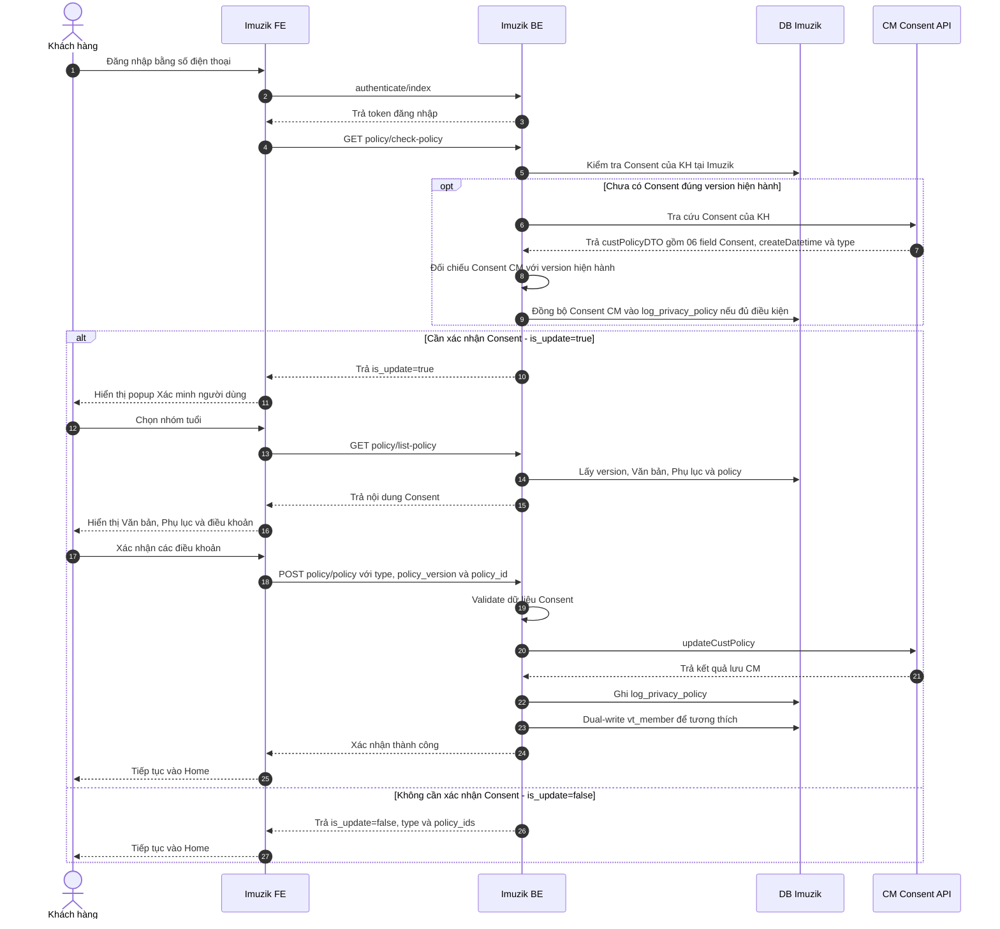
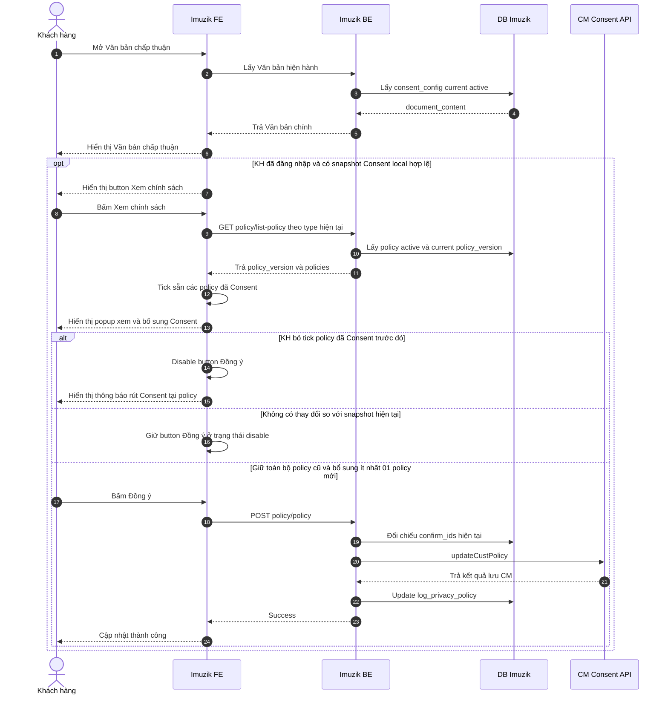

# TÀI LIỆU ĐẶC TẢ YÊU CẦU CHỨC NĂNG

**Giải pháp cập nhật và quản lý Consent khách hàng trên Imuzik**

| Thông tin | Nội dung |
|---|---|
| Tên yêu cầu / dự án | Cập nhật và quản lý Consent khách hàng trên Imuzik |
| Nền tảng áp dụng | App Imuzik |
| Phiên bản | 1.0 |
| Ngày ban hành | 06/10/2026 |
| PIC | SơnLH21 |

## 1. Lịch sử thay đổi

| Ngày | Phiên bản | PIC | Phạm vi thay đổi | Mô tả |
|---|---|---|---|---|
| 06/10/2026 | 1.0 | SơnLH21 | Toàn bộ tài liệu | Ban hành tài liệu giải pháp cập nhật và quản lý Consent khách hàng trên Imuzik |

## 2. Thông tin tổng quan

### 2.1 Hiện trạng và mục tiêu thay đổi

Imuzik hiện có cơ chế xác nhận chính sách và dữ liệu người dùng phục vụ quyết định hiển thị popup. Yêu cầu mới chuẩn hóa luồng Consent theo hướng Imuzik tự quản lý version, nội dung Văn bản Consent, Phụ lục, điều khoản và trạng thái Consent local; đồng thời tích hợp CM để kiểm tra/lưu 06 giá trị Consent theo số thuê bao.

Mục tiêu nghiệp vụ:

- Imuzik tự quản lý `current_policy_version`, Văn bản Consent, 02 Phụ lục theo nhóm tuổi và rule điều khoản.
- Trạng thái Consent local được quản lý tại `log_privacy_policy` trong DB `imuzik`.
- `vt_member.is_update_policy` và `vt_member.policy_id` chỉ được dual-write để tương thích luồng cũ, không phải source of truth của luồng Consent mới.
- Khách hàng tự xác nhận nhóm tuổi trước khi xem nội dung Consent: `type=0` từ 16 tuổi trở lên, `type=1` dưới 16 tuổi.
- Văn bản Consent gồm 01 nội dung HTML dùng chung và 02 Phụ lục theo `type`; mỗi Phụ lục lưu dưới dạng JSON string.
- Danh sách 06 điều khoản được quản lý tại bảng `policy`, trong đó `policy.name` mapping trực tiếp với 06 field Consent của CM.
- Khách hàng chỉ tiếp tục sử dụng phiên đăng nhập khi đã đáp ứng Consent hiện hành; action **Không phải bây giờ** thực hiện logout và quay lại màn hình đăng nhập.
- Khi lỗi cấu hình/nội dung Consent thuộc nhóm fail-open, hệ thống cho phép tiếp tục trong lần đăng nhập hiện tại nhưng không ghi nhận khách hàng đã Consent.
- Mục **Văn bản chấp thuận/Chính sách** luôn hiển thị Văn bản chính. Chỉ khi khách hàng đã đăng nhập **và có snapshot Consent local hợp lệ của version hiện hành**, hệ thống mới hiển thị button **Xem chính sách** để mở popup xem/cập nhật lựa chọn Mục đích xử lý dữ liệu cá nhân theo nguyên tắc chỉ được bổ sung Consent, không được bỏ Consent đã xác nhận trước đó. Trường hợp đã đăng nhập theo nhánh fail-open nhưng không có snapshot local được hiển thị như khách hàng chưa đăng nhập.

### 2.2 Phạm vi

**Trong phạm vi nghiệp vụ**

- Đăng nhập Imuzik bằng số điện thoại.
- Kiểm tra khách hàng có cần thực hiện Consent sau khi đăng nhập.
- Kiểm tra Consent local theo `policy_version`; chỉ gọi CM khi chưa có local log hoặc local log khác version hiện hành.
- Khi phải kiểm tra CM, hệ thống đối chiếu `custPolicyDTO.createDatetime` với `consent_config.created_at` của version hiện hành. Nếu Consent CM đáp ứng đầy đủ policy bắt buộc và thời điểm Consent không trước version hiện hành thì công nhận Consent tương ứng version hiện hành và đồng bộ snapshot vào `log_privacy_policy`.
- Khi công nhận Consent từ CM, `confirm_ids` được mapping từ các field `custPolicyDTO` có giá trị `1`; `type` lấy từ dữ liệu CM để phục vụ lưu local và hiển thị đúng Phụ lục.
- Popup **Xác minh người dùng** với 03 action: **16 tuổi trở lên**, **Dưới 16 tuổi**, **Không phải bây giờ**.
- Hiển thị Văn bản Consent, Phụ lục theo nhóm tuổi, 06 điều khoản và `policy.note` nếu có.
- Xác nhận chung và validation các policy bắt buộc theo `is_required`.
- Lưu Consent tại CM và `log_privacy_policy` local.
- Validate `policy_version` tại thời điểm lưu để bảo đảm khách hàng xác nhận đúng version đã được hiển thị.
- Fail-open khi lỗi đọc cấu hình hoặc thiếu Văn bản/Phụ lục/danh sách policy theo rule tại Mục 4.
- Dual-write `vt_member.is_update_policy` và `vt_member.policy_id` sau khi lưu local thành công để tương thích luồng cũ.
- Mục **Văn bản chấp thuận/Chính sách**: hiển thị Văn bản chính; khách hàng đã đăng nhập được phép mở popup để bổ sung thêm điều khoản Consent chưa chọn.

**Ngoài phạm vi**

- Đăng nhập Google/Facebook hoặc các hình thức đăng nhập ngoài phạm vi số điện thoại.
- CMS quản trị Văn bản Consent/Phụ lục.
- Thu thập hoặc xác minh thông tin người giám hộ cho khách hàng dưới 16 tuổi.
- Chức năng bỏ/rút Consent đối với điều khoản đã xác nhận trước đó. UC02 chỉ cho phép bổ sung thêm điều khoản chưa Consent.
- Cơ chế pending/resync để đồng bộ bù CM khi SAVE CM thất bại nhưng Consent local đã được ghi nhận.

### 2.3 Thuật ngữ viết tắt

| STT | Thuật ngữ | Mô tả |
|---:|---|---|
| 1 | Imuzik FE | Thành phần giao diện Imuzik trên kênh triển khai tương ứng |
| 2 | Imuzik BE | Backend Imuzik xử lý nghiệp vụ Consent |
| 3 | CM | Hệ thống quản lý tập trung dữ liệu Consent |
| 4 | Consent | Xác nhận/lựa chọn của khách hàng đối với các mục đích xử lý dữ liệu cá nhân |
| 5 | `current_policy_version` | Version Consent hiện hành do Imuzik quản lý |
| 6 | `policy_version` | Version Consent tại thời điểm khách hàng xem/xác nhận |
| 7 | Policy bắt buộc | Policy active có `is_required=1`; khách hàng bắt buộc Consent để được tiếp tục |
| 8 | `policy.name` | Key nghiệp vụ/tích hợp tương ứng trực tiếp với 06 field Consent của CM |
| 9 | `type` | Nhóm tuổi: `0` từ 16 tuổi trở lên; `1` dưới 16 tuổi |
| 10 | Fail-open | Cho phép tiếp tục phiên đăng nhập khi lỗi cấu hình/nội dung Consent thuộc phạm vi cho phép; không ghi nhận khách hàng đã Consent |

### 2.4 Tài liệu tham khảo

| STT | Tài liệu | Mục đích sử dụng |
|---:|---|---|
| 1 | PYC cập nhật Văn bản Consent Imuzik | Nguồn yêu cầu nghiệp vụ Imuzik |
| 2 | PYC-64913 - API CM kiểm tra/lưu Consent | Contract và xử lý tích hợp CM |
| 3 | Văn bản chấp thuận xử lý và bảo vệ dữ liệu cá nhân tại VTT | Nội dung Văn bản Consent và 06 mục đích xử lý dữ liệu |
| 4 | API/FE Consent MyClip | Tham chiếu cơ chế version, local log và nội dung Consent |
| 5 | API xác nhận chính sách Imuzik | Hiện trạng API/chức năng Consent Imuzik |
| 6 | FE xác nhận chính sách Imuzik | Hiện trạng giao diện và xử lý Consent Imuzik |

### 2.5 Nguyên tắc giải pháp

- `policy.id` là khóa kỹ thuật; `policy.name` là key mapping CM; `sortorder` xác định thứ tự Điều khoản 1-6.
- `is_required` xác định policy bắt buộc; `is_editable` chỉ xác định trạng thái tick mặc định, không dùng để sinh nội dung `note`.
- `policy.note` là nội dung ghi chú độc lập; có dữ liệu thì hiển thị dưới `description`, không tham gia validation.
- Mỗi `policy_version` có 01 Văn bản Consent HTML dùng chung và 02 Phụ lục theo `type`; Phụ lục lưu dạng JSON string gồm `title`, `warning`, `parent_content`, `confirm_content`.
- `policy_version` được xác lập khi INSERT bản ghi `consent_config` mới; UPDATE bản ghi hiện tại không tự tăng version.
- Local log cùng `current_policy_version` được công nhận đã hoàn tất Consent mà không đối chiếu lại `confirm_ids` và không gọi CM.
- Imuzik tự quyết định nghiệp vụ Consent; không sử dụng `consent`, `displayConsent`, `systemType` của CM để quyết định hiển thị/chặn.
- CM trả dữ liệu 06 giá trị Consent và `createDatetime`; `createDatetime` được dùng để đối chiếu với `consent_config.created_at` của version hiện hành. `policy_version` vẫn do Imuzik quản lý.
- Để đồng bộ đầy đủ Consent từ CM và hiển thị đúng Phụ lục khi xem lại VBCT, CM cần lưu/trả thêm `type` theo mapping `0`: từ 16 tuổi trở lên, `1`: dưới 16 tuổi.

## 3. Yêu cầu về chức năng

### 3.1 UC01 - Kiểm tra và xác nhận Consent khi đăng nhập Imuzik

#### 3.1.1 Mô tả chung

| Thông tin | Nội dung |
|---|---|
| Actor chính | Khách hàng đăng nhập Imuzik bằng số điện thoại |
| Mục đích / Mô tả | Kiểm tra dữ liệu Consent hiện có, đối chiếu với rule/version của Imuzik và yêu cầu khách hàng xác nhận lại khi chưa đáp ứng |
| Hệ thống thực hiện | Imuzik FE, Imuzik BE, DB Imuzik, CM |
| Trigger | Khách hàng đăng nhập thành công bằng số điện thoại |
| Điều kiện đầu vào | Imuzik xác định được user/MSISDN; hệ thống đọc được cấu hình Consent hiện hành |
| Điều kiện đầu ra thành công | Khách hàng đáp ứng rule Consent hiện hành và tiếp tục vào Home |
| Điều kiện đầu ra chưa xác nhận | Khách hàng nhấn **Không phải bây giờ** → logout và quay lại màn hình đăng nhập |
| Điều kiện đầu ra không thành công | Không cho vào Home khi khách hàng chưa đáp ứng rule bắt buộc hoặc API/hệ thống Imuzik trả lỗi không thuộc case fallback đã mô tả |
| Link Figma | N/A |

#### 3.1.2 Sơ đồ luồng Sequence Diagram



#### 3.1.3 Mô tả luồng xử lý

##### Bước 1 - Imuzik FE: Gọi API kiểm tra Consent

Sau khi khách hàng đăng nhập thành công bằng số điện thoại, FE gọi API kiểm tra có cần thực hiện luồng Consent hay không.

**API**

```http
GET policy/check-policy
```

**Request**

| Field | Bắt buộc | Nguồn | Mô tả |
|---|---:|---|---|
| `token` | Có | API `authenticate/index` | Token xác thực người dùng; BE sử dụng để xác định user/MSISDN |
| `authorization_code` | Không | Cơ chế authorization hiện tại | Giữ theo contract API hiện tại |

Ví dụ:

```http
GET policy/check-policy?token=<token>&authorization_code=<authorization_code>
```

FE không tự đánh giá trạng thái Consent. Toàn bộ logic xác định `is_update`, `type`, `policy_ids` được xử lý tại Imuzik BE ở Bước 2.

##### Bước 2 - Imuzik BE: Xử lý kiểm tra Consent

###### Bước 2.1 - Lấy cấu hình Consent hiện hành từ DB

Bổ sung bảng `consent_config` theo mô tả tại Mục 5.3 để quản lý version, Văn bản Consent và Phụ lục.

Imuzik BE thực hiện:

1. Query bản ghi `consent_config` đang `is_current=1` và `status=active`.
2. Lấy `policy_version` của bản ghi này và gán nội bộ thành `current_policy_version`.
3. Nếu lỗi đọc `consent_config` **hoặc không tồn tại cấu hình current/active** → ghi log lỗi và xử lý fail-open: `GET policy/check-policy` trả success với `is_update=false`, không tạo/cập nhật `log_privacy_policy`, cho phép tiếp tục đăng nhập trong lần hiện tại. Lần đăng nhập sau hệ thống thực hiện kiểm tra lại.

**Output nội bộ**

```text
current_policy_version = <consent_config.policy_version của bản ghi current>
```

###### Bước 2.2 - Kiểm tra `log_privacy_policy`

Bảng `log_privacy_policy` được lưu tại DB `imuzik` theo mô tả tại Mục 5.4.

Imuzik BE thực hiện kiểm tra thông tin Consent của user:

- **TH1: Không tồn tại bản ghi của user đăng nhập:**
  - User chưa từng thực hiện Consent tại Imuzik → chuyển Bước 2.3 để gọi CM kiểm tra Consent tập trung.

- **TH2: Có bản ghi và `log_privacy_policy.policy_version = current_policy_version`:**
  - User đã thực hiện Consent version mới nhất tại Imuzik.
  - Xác định `is_update=false`.
  - Lấy `type = log_privacy_policy.type`.
  - Lấy `policy_ids` từ `log_privacy_policy.confirm_ids`.

- **TH3: Có bản ghi và `log_privacy_policy.policy_version != current_policy_version`:**
  - User chưa thực hiện Consent version mới nhất tại Imuzik → chuyển Bước 2.3 để gọi CM kiểm tra Consent tập trung.
  - Giữ `type` của bản ghi local gần nhất để phục vụ thông tin hiển thị nếu cần; không dùng `confirm_ids` cũ để quyết định `is_update`.

###### Bước 2.3 - Thực hiện gọi hàm `getCustPolicy` bên CM

**API**

```soap
getCustPolicy
```

**Request**

```text
isdn = <MSISDN của user đang đăng nhập>
```

**Response**

CM trả response SOAP, Imuzik chỉ sử dụng các dữ liệu sau cho luồng kiểm tra Consent:

```json
{
  "code": "0",
  "description": "success",
  "custPolicyDTO": {
    "provideProduct": "1",
    "supportCustomer": "1",
    "improveQuality": "1",
    "marketingAdvertising": "0",
    "researchMarket": "0",
    "tradePromotion": "0",
    "createDatetime": "2026-10-02T15:02:49+07:00",
    "type": 0
  }
}
```

`type` là thông tin cần CM bổ sung/lưu trả trong `custPolicyDTO`; tên field và contract chính thức **Cần CM xác nhận**. Nghiệp vụ đã chốt: nếu response không có `type` hợp lệ thì xác định dữ liệu Consent CM chưa đầy đủ và trả `is_update=true`.

**Xử lý kết quả gọi CM và đối chiếu với version hiện hành**

1. `code = 0` và `custPolicyDTO` có dữ liệu:

   **Bước 1 - Kiểm tra thời điểm Consent trên CM**
   - Nếu `custPolicyDTO.createDatetime` rỗng/không hợp lệ → dữ liệu Consent CM chưa đủ căn cứ để công nhận cho version hiện hành → trả `is_update=true`.
   - Nếu `custPolicyDTO.createDatetime < consent_config.created_at` → Consent trên CM được thực hiện trước version Consent hiện hành → trả `is_update=true`.
   - Nếu `custPolicyDTO.createDatetime >= consent_config.created_at` → tiếp tục Bước 2.

   **Bước 2 - Kiểm tra `type`**
   - Nếu CM không trả `type` hợp lệ (`0` hoặc `1`) → dữ liệu Consent CM chưa đầy đủ → trả `is_update=true`.
   - Nếu `type` hợp lệ → tiếp tục Bước 3.

   **Bước 3 - Kiểm tra các điều khoản bắt buộc**
   - Lấy danh sách policy active; dùng `policy.name` để mapping với field cùng tên trong `custPolicyDTO`.
   - Kiểm tra toàn bộ policy active có `is_required=1`:
     - nếu có ít nhất 01 policy bắt buộc có giá trị CM tương ứng khác `1` → xác định KH chưa Consent đầy đủ → trả `is_update=true`;
     - nếu toàn bộ policy bắt buộc đều có giá trị CM tương ứng bằng `1` → công nhận Consent trên CM tương ứng với version hiện hành của Imuzik và chuyển Bước 4.

   **Bước 4 - Ghi nhận Consent CM vào Imuzik**
   - Map tất cả policy active có field CM tương ứng bằng `1` thành `confirm_ids`.
   - INSERT/UPDATE `log_privacy_policy` với `is_consent=1`, `type=<type CM>`, `policy_version=current_policy_version`, `confirm_ids=<mapping từ CM>`.
   - Sau khi ghi local thành công, dual-write `vt_member` theo rule tương thích hiện tại.
   - Trả `is_update=false`, `type`, `policy_ids` từ snapshot local vừa ghi.

2. `code = 0` nhưng `custPolicyDTO` không có dữ liệu (`null`/rỗng):
   - Xác định User chưa Consent đầy đủ các điều khoản bắt buộc.
   - Response `is_update=true`.

3. CM trả `code != 0`:
   - Xác định User chưa Consent đầy đủ các điều khoản bắt buộc.
   - Response `is_update=true`.

4. Timeout/lỗi server/lỗi kết nối:
   - Retry tối đa 3 lần gọi `getCustPolicy`.
   - Nếu trong quá trình retry nhận được response từ CM thì xử lý theo mục 1, 2 hoặc 3 tương ứng.
   - Nếu sau 3 lần vẫn lỗi kỹ thuật → fail-open: trả `is_update=false` cho lần đăng nhập hiện tại, không tạo/cập nhật `log_privacy_policy`; lần đăng nhập sau kiểm tra lại.

**Dữ liệu bổ sung phục vụ response/menu Chính sách**

- `is_update=false` từ local log cùng version → `type`, `policy_ids` lấy từ `log_privacy_policy`.
- `is_update=false` do Consent CM được công nhận cho version hiện hành → trước khi trả response phải ghi/cập nhật `log_privacy_policy`; `type`, `policy_ids` lấy từ snapshot local vừa ghi.
- Fail-open do CM lỗi kỹ thuật sau 3 lần → không tạo/cập nhật local log và không coi KH đã Consent.

**Các mã `code != 0` CM đã xác định trong luồng chỉ truyền `isdn`**

| Code CM | Description |
|---|---|
| `PYC_62335_1` | `Phải truyền một trong hai tham số isdn hoặc idNo` |
| `PYC_62335_3` | `Thuê bao không tồn tại hoặc không hoạt động trên hệ thống` |
| `PYC_62335_5` | `Không tìm thấy thông tin giấy tờ của khách hàng` |

`PYC_62335_2` và `PYC_62335_4` chỉ phát sinh khi truyền `idNo`/`idType`, không thuộc request Imuzik hiện tại.

##### Bước 3 - Imuzik BE/FE: Trả response và xử lý response `GET policy/check-policy`

###### Bước 3.1 - Response thành công

**TH1 - Cần xác nhận Consent (`is_update=true`)**

Khi KH chưa có Consent hợp lệ cho version hiện hành, API chỉ trả trạng thái cần cập nhật; **không trả `type` và `policy_ids`**.

```json
{
  "errorCode": "000000",
  "message": "Successful",
  "data": {
    "is_update": true
  }
}
```

FE chuyển sang Bước 4 và hiển thị popup **Xác minh người dùng**.

**TH2 - Không cần xác nhận Consent (`is_update=false`) và đã có snapshot Consent local hợp lệ**

```json
{
  "errorCode": "000000",
  "message": "Successful",
  "data": {
    "is_update": false,
    "type": 0,
    "policy_ids": [1, 2, 3]
  }
}
```

Trong đó:

- `type`: nhóm tuổi lấy từ `log_privacy_policy.type`.
- `policy_ids`: danh sách `policy.id` đã Consent lấy từ `log_privacy_policy.confirm_ids`.
- Snapshot local có thể được tạo từ Consent trực tiếp trên Imuzik hoặc từ Consent CM đã được công nhận và đồng bộ tại Bước 2.3.
- FE không hiển thị popup Consent và tiếp tục vào Home.

**TH3 - Fail-open (`is_update=false`) nhưng không có snapshot Consent local**

Nếu `is_update=false` do lỗi kỹ thuật thuộc nhánh fail-open, API không trả `type`/`policy_ids` vì KH chưa được coi là đã Consent và không có snapshot local hợp lệ.

```json
{
  "errorCode": "000000",
  "message": "Successful",
  "data": {
    "is_update": false
  }
}
```

###### Bước 3.2 - Response lỗi

| `errorCode` | `message` | Trường hợp | Xử lý FE |
|---|---|---|---|
| `000001` | `Hệ thống đang bận, vui lòng thử lại sau.` | Lỗi kết nối/xử lý DB Imuzik | Hiển thị lỗi hệ thống; không tiếp tục luồng Consent |
| `000003` | `Unknown method` | Gọi sai HTTP method, khác `GET` | Hiển thị lỗi kỹ thuật/không tiếp tục xử lý |
| `300002` | `Invalid authorization code` | Có truyền `authorization_code` nhưng không hợp lệ/hết hiệu lực | Dừng xử lý; thực hiện lại cơ chế authorization theo luồng hiện tại |
| `000002` | `Require login.` | Không truyền `token`/không có thông tin đăng nhập hợp lệ | Yêu cầu đăng nhập lại |
| `000008` | `Token không hợp lệ.` | `token` không tồn tại hoặc hết hiệu lực | Yêu cầu đăng nhập lại |

##### Bước 4 - Imuzik FE: Hiển thị popup Xác minh người dùng

Khi kết quả kiểm tra Consent xác định `is_update=true`, FE hiển thị popup theo design **Xác minh người dùng**.

**Nội dung hiển thị**

- Tiêu đề: **Xác minh người dùng**.
- Nội dung hướng dẫn: **"Vui lòng xác nhận người dùng. Đối với trẻ em dưới 16 tuổi cần có sự đồng ý của cha, mẹ, người giám hộ về việc xử lý dữ liệu cá nhân khi sử dụng dịch vụ Imuzik. Đối với người bị mất/hạn chế năng lực hành vi dân sự vui lòng ra các cửa hàng của Viettel để được hỗ trợ."**

| Thành phần | Giá trị nghiệp vụ | Xử lý |
|---|---|---|
| **16 tuổi trở lên** | `type=0` | Khách hàng bấm button → FE ghi nhận `type=0` và chuyển ngay Bước 5 |
| **Dưới 16 tuổi** | `type=1` | Khách hàng bấm button → FE ghi nhận `type=1` và chuyển ngay Bước 5 |
| **Không phải bây giờ** | Không ghi nhận `type` | Logout khách hàng và quay lại màn hình đăng nhập |

**Xử lý tại FE**

- Không sử dụng radio chọn nhóm tuổi.
- Không có button **Tiếp tục**.
- Việc bấm một trong hai button nhóm tuổi đồng thời là thao tác chọn `type` và tiếp tục lấy nội dung Consent.
- Khi bấm **Không phải bây giờ**:
  - thực hiện logout theo cơ chế hiện tại;
  - điều hướng về màn hình đăng nhập;
  - không cho khách hàng tiếp tục vào Home trong phiên đăng nhập hiện tại.

##### Bước 5 - Imuzik FE: Gọi API lấy Văn bản Consent và danh sách policy

Sau khi khách hàng bấm một trong hai button nhóm tuổi tại Bước 4, FE gọi API lấy Văn bản Consent, Phụ lục và danh sách policy tương ứng.

**API**

```http
GET policy/list-policy
```

**Request**

| Field | Bắt buộc | Nguồn | Mô tả |
|---|---:|---|---|
| `type` | Có | Giá trị khách hàng chọn tại Bước 4 | `0`: từ 16 tuổi trở lên; `1`: dưới 16 tuổi |
| `token` | Có | API `authenticate/index` | Token xác thực người dùng |
| `authorization_code` | Không | Cơ chế authorization hiện tại | Giữ theo contract hiện tại |

Ví dụ:

```http
GET policy/list-policy?type=0&token=<token>&authorization_code=<authorization_code>
```

##### Bước 6 - Imuzik BE: Xử lý lấy Văn bản Consent, Phụ lục và danh sách policy

Imuzik BE thực hiện:

1. Validate thông tin request:
   - Request sử dụng đúng method `GET`;
   - `token` được truyền và còn hiệu lực;
   - `authorization_code` hợp lệ nếu có truyền;
   - `type ∈ {0,1}`.
2. Query bản ghi `consent_config` đang `is_current=1` và `status=active`.
3. Lấy `policy_version` của bản ghi và gán nội bộ thành `current_policy_version`.
4. Lấy `document_content` - Văn bản Consent HTML dùng chung cho cả 02 nhóm tuổi.
5. Căn cứ `type` để lấy Phụ lục:
   - `type = 0` → lấy chuỗi `appendix_type_0_content`;
   - `type = 1` → lấy chuỗi `appendix_type_1_content`.
6. Trả nguyên chuỗi Phụ lục đã chọn ra field `appendix_content`; BE không tách thành nhiều field con.
7. Lấy danh sách policy thỏa mãn `policy.is_active = 1`, sắp xếp theo `policy.sortorder ASC`, bao gồm `note` nếu có.
8. Nếu toàn bộ dữ liệu hợp lệ → trả response thành công cho FE; xử lý response tại Bước 7.1.
9. Nếu lỗi đọc cấu hình hoặc thiếu `document_content`/Phụ lục/danh sách policy → trả mã lỗi tương ứng để FE xử lý fail-open tại Bước 7.2; không tạo/cập nhật `log_privacy_policy`. Các lỗi request/auth/validation khác xử lý theo mã lỗi thông thường.

**Truy vấn policy**

```sql
SELECT id, description, note, is_required, is_editable
FROM policy
WHERE is_active = 1
ORDER BY sortorder ASC;
```

**Các trường hợp lỗi**

| `errorCode` | `message` | Trường hợp |
|---|---|---|
| `000001` | `Hệ thống đang bận, vui lòng thử lại sau.` | Lỗi truy vấn DB hoặc không tồn tại `consent_config` đang `is_current=1`, `status=active` |
| `000003` | `Unknown method` | Request sử dụng method khác `GET` |
| `300002` | `Invalid authorization code` | Có truyền `authorization_code` nhưng không hợp lệ/hết hiệu lực |
| `000002` | `Require login.` | Không truyền `token`/không có thông tin đăng nhập hợp lệ |
| `000008` | `Token không hợp lệ.` | `token` không tồn tại hoặc hết hiệu lực |
| `130004` | `Nhóm tuổi không hợp lệ.` | Không truyền `type` hoặc `type` không thuộc `{0,1}` |
| `130005` | `Không tìm thấy Văn bản Consent hiện hành.` | `consent_config.document_content` không có dữ liệu |
| `130006` | `Không tìm thấy Phụ lục Consent phù hợp.` | Không có nội dung Phụ lục tương ứng với `type` khách hàng đã chọn |
| `130007` | `Không tìm thấy danh sách điều khoản Consent.` | Không tồn tại policy có `is_active = 1` |

##### Bước 7 - Imuzik FE: Xử lý response `GET policy/list-policy`

###### Bước 7.1 - Response thành công

**Response**

```json
{
  "errorCode": "000000",
  "message": "Successful",
  "data": {
    "policy_version": "<current_policy_version>",
    "type": 0,
    "document_content": "<HTML Văn bản Consent>",
    "appendix_content": "{\"title\":\"Văn bản chấp thuận về việc xử lý và bảo vệ dữ liệu cá nhân\",\"warning\":\"\",\"parent_content\":\"Tôi xác nhận đã đọc, hiểu và đồng ý đối với toàn bộ nội dung và các mục đích xử lý dữ liệu theo quy định tại Văn bản chấp thuận về xử lý và bảo vệ dữ liệu cá nhân.\",\"confirm_content\":\"\"}",
    "policies": [
      {
        "id": 1,
        "description": "<Nội dung điều khoản>",
        "note": "<Ghi chú điều khoản hoặc null>",
        "is_required": 1,
        "is_editable": 0
      }
    ]
  }
}
```

Trong đó:

- `policy_version`: version Consent hiện hành lấy từ `consent_config`.
- `document_content`: 01 Văn bản Consent HTML dùng chung, không phụ thuộc `type`.
- `appendix_content`: chuỗi JSON của Phụ lục đã được BE chọn theo `type`.
- Cấu trúc JSON trong `appendix_content` gồm:
  - `title`;
  - `warning`;
  - `parent_content`;
  - `confirm_content`.
- FE parse chuỗi `appendix_content` để lấy các thành phần và render; BE không trả các nội dung Phụ lục thành nhiều field riêng.
- `note`: ghi chú bổ sung của policy; có thể `null`/rỗng.
- `is_required`: xác định policy bắt buộc khách hàng phải Consent để được tiếp tục.
- `is_editable`: xác định trạng thái mặc định tick của policy trên FE.
- `sortorder`: sử dụng tại BE để xác định thứ tự Điều khoản 1-6 và thứ tự trả danh sách policy; không bắt buộc trả về FE.
- `policy.name`: sử dụng tại BE để mapping với field cùng tên của CM; không bắt buộc trả về FE.

**Xử lý tại FE**

- Hiển thị `document_content` - Văn bản Consent dùng chung.
- Parse `appendix_content` và hiển thị nội dung Phụ lục tương ứng nhóm tuổi khách hàng đã chọn.
- Hiển thị danh sách policy theo đúng thứ tự BE trả về.
- Nếu `policy.note` có dữ liệu → hiển thị dưới `description`; nếu `null`/rỗng → không hiển thị vùng ghi chú. `note` không tham gia validation.
- Thiết lập trạng thái tick mặc định của từng policy theo `is_editable`.
- Bổ sung control **Xác nhận chung** dạng tick chọn trên popup:
  - khi khách hàng tick **Xác nhận chung** → FE tự động tick toàn bộ policy đang hiển thị, bao gồm policy bắt buộc và không bắt buộc;
  - sau khi tick toàn bộ, FE tiếp tục áp dụng rule kiểm tra `is_required` để xác định trạng thái button **Xác nhận/Đồng ý**.
- Kiểm tra các policy có `is_required = 1`:
  - nếu còn ít nhất một policy bắt buộc chưa được tick → disable button **Xác nhận/Đồng ý**;
  - nếu toàn bộ policy bắt buộc đã được tick → enable button **Xác nhận/Đồng ý**.
- Các policy có `is_required = 0` không ảnh hưởng điều kiện cho phép khách hàng tiếp tục.

- Có nút **Quay lại**: khi bấm, đóng MH02 và quay về MH01 để khách hàng chọn lại nhóm tuổi; chưa ghi nhận Consent và chưa gọi API lưu. Sau khi chọn lại `type`, FE thực hiện lại Bước 5.

Khi khách hàng nhấn **Xác nhận/Đồng ý** → chuyển Bước 8.

###### Bước 7.2 - Response lỗi

FE xử lý response lỗi của `GET policy/list-policy` như sau:

| `errorCode` | `message` | Xử lý FE |
|---|---|---|
| `000001` | `Hệ thống đang bận, vui lòng thử lại sau.` | Nếu phát sinh do lỗi đọc cấu hình/nội dung tại Bước 6: ghi log và fail-open, đóng luồng Consent và tiếp tục Home; không ghi local Consent. Các lỗi hệ thống khác xử lý theo cơ chế hiện tại |
| `000003` | `Unknown method` | Hiển thị lỗi kỹ thuật; không tiếp tục xử lý |
| `300002` | `Invalid authorization code` | Dừng xử lý; thực hiện lại cơ chế authorization theo luồng hiện tại |
| `000002` | `Require login.` | Yêu cầu khách hàng đăng nhập lại |
| `000008` | `Token không hợp lệ.` | Yêu cầu khách hàng đăng nhập lại |
| `130004` | `Nhóm tuổi không hợp lệ.` | Quay lại popup **Xác minh người dùng** để khách hàng chọn lại nhóm tuổi |
| `130005` | `Không tìm thấy Văn bản Consent hiện hành.` | Ghi log và fail-open: bỏ qua Consent trong lần đăng nhập hiện tại, tiếp tục Home; không ghi `log_privacy_policy` |
| `130006` | `Không tìm thấy Phụ lục Consent phù hợp.` | Ghi log và fail-open: bỏ qua Consent trong lần đăng nhập hiện tại, tiếp tục Home; không ghi `log_privacy_policy` |
| `130007` | `Không tìm thấy danh sách điều khoản Consent.` | Ghi log và fail-open: bỏ qua Consent trong lần đăng nhập hiện tại, tiếp tục Home; không ghi `log_privacy_policy` |

**Ví dụ response lỗi**

```json
{
  "errorCode": "130004",
  "message": "Nhóm tuổi không hợp lệ.",
  "data": null
}
```

##### Bước 8 - Imuzik FE: Gọi API lưu Consent

Sau khi khách hàng hoàn tất lựa chọn policy và nhấn **Xác nhận/Đồng ý** tại Bước 7, FE gửi nhóm tuổi, `policy_version` đã được hiển thị và danh sách policy khách hàng đã Consent về Imuzik BE.

**API**

```http
POST policy/policy
```

**Request**

| Field | Bắt buộc | Nguồn | Mô tả |
|---|---:|---|---|
| `token` | Có | API `authenticate/index` | Xác định user/MSISDN |
| `authorization_code` | Không | Cơ chế authorization hiện tại | Giữ theo contract API hiện tại |
| `type` | Có | Giá trị khách hàng đã chọn tại Bước 4 | Nhóm tuổi dùng để xác định Phụ lục đã hiển thị |
| `policy_version` | Có | Response Bước 7 | Version Consent khách hàng đã được hiển thị |
| `policy_id` | Có | Danh sách policy khách hàng đã tick | Danh sách `policy.id`, phân tách bằng dấu `,` |

Ví dụ:

```json
{
  "token": "<token>",
  "authorization_code": "<authorization_code>",
  "type": 0,
  "policy_version": "1.0",
  "policy_id": "1,2,3"
}
```

FE gửi lại đúng `policy_version` đã nhận tại Bước 7. Imuzik BE sử dụng giá trị này để kiểm tra khách hàng đang xác nhận đúng version Consent hiện hành trước khi lưu.

Sau khi FE gửi request → chuyển Bước 9.

##### Bước 9 - Imuzik BE: Xử lý và validate thông tin Consent

Sau khi nhận request `POST policy/policy`, Imuzik BE thực hiện:

1. Validate thông tin request:
   - Request sử dụng đúng method `POST`;
   - `token` được truyền, còn hiệu lực và xác định được user/MSISDN;
   - `authorization_code` hợp lệ nếu có truyền;
   - `type ∈ {0,1}`;
   - `policy_version` được truyền;
   - `policy_id` đúng định dạng. Nếu sai định dạng → trả `130002`.
2. Lấy bản ghi `consent_config` đang `is_current=1` và `status=active`, xác định `current_policy_version`.
3. So sánh `policy_version` FE gửi lên với `current_policy_version`:
   - Nếu khác nhau → trả `130009`, không gọi CM.
   - Nếu giống nhau → tiếp tục xử lý.
4. Kiểm tra toàn bộ `policy_id` truyền lên tồn tại và có `policy.is_active = 1`:
   - Nếu có ID không tồn tại/không active → trả `130003`, không gọi CM.
5. Lấy danh sách policy bắt buộc thỏa mãn:
   - `policy.is_active = 1`;
   - `policy.is_required = 1`.
6. Kiểm tra toàn bộ policy bắt buộc có trong danh sách `policy_id` khách hàng gửi lên:
   - Nếu thiếu ít nhất một policy bắt buộc → trả `130008`, không gọi CM.
   - Nếu đầy đủ → tiếp tục xử lý.
7. Nếu toàn bộ dữ liệu hợp lệ → chuyển Bước 10 để build dữ liệu và gọi CM lưu Consent.

**Lưu ý**

- `130002` giữ đúng ý nghĩa hiện trạng: `Sai định dạng tham số truyền vào!`.
- `130003` giữ đúng ý nghĩa hiện trạng: `Nhập id không tồn tại!`.
- `type` và `policy_version` request đã được validate được lưu tại `log_privacy_policy`, qua đó xác định đúng Phụ lục/version khách hàng đã được hiển thị/xác nhận tại thời điểm Consent.

##### Bước 10 - Imuzik BE: Gọi hàm `updateCustPolicy` bên CM

Sau khi validate thành công, Imuzik BE build `custPolicyDTO` đủ 06 field và gọi hàm `updateCustPolicy` bên CM.

**Nguyên tắc mapping**

- Lấy `policy.name` để xác định field tương ứng trong `custPolicyDTO`.
- Nếu `policy.id` có trong danh sách `policy_id` khách hàng đã Consent → field CM cùng tên = `1`.
- Nếu `policy.id` không có trong danh sách `policy_id` khách hàng đã Consent → field CM cùng tên = `0`.

Ví dụ:

```json
{
  "provideProduct": "1",
  "supportCustomer": "1",
  "improveQuality": "1",
  "marketingAdvertising": "0",
  "researchMarket": "0",
  "tradePromotion": "0"
}
```

**API**

```soap
updateCustPolicy
```

**Request**

```text
isdn = <MSISDN của user đang đăng nhập>
custPolicyDTO = <06 giá trị Consent>
```

**Xử lý kết quả gọi CM**

1. CM trả `code = 0`:
   - Xác định lưu Consent CM thành công.
   - Chuyển Bước 11 để ghi nhận Consent tại Imuzik.

2. CM trả `code != 0`:
   - Không retry do đã nhận được response nghiệp vụ từ CM.
   - Ghi log `code`/`description` để phục vụ theo dõi lỗi tích hợp.
   - Không block luồng Consent; vẫn chuyển Bước 11 để ghi nhận Consent local tại Imuzik.

3. Timeout/lỗi server/lỗi kết nối:
   - Retry tối đa 3 lần gọi `updateCustPolicy`.
   - Nếu trong quá trình retry nhận được response từ CM → xử lý theo mục 1 hoặc 2 tương ứng.
   - Nếu sau 3 lần vẫn lỗi kỹ thuật → không block luồng Consent, vẫn chuyển Bước 11 để ghi nhận Consent local.

**Các mã `code != 0` của `updateCustPolicy` đã xác định**

| Code CM | Description | Ghi chú |
|---|---|---|
| `PYC_64913_1` | `Tham số truyền vào không đủ (isdn)` | Theo thiết kế Imuzik luôn truyền `isdn`; nếu phát sinh cần ghi log cảnh báo lỗi tích hợp |
| `PYC_64913_2` | `Thuê bao không tồn tại hoặc không hoạt động trên hệ thống` | Lỗi nghiệp vụ phía CM |
| `PYC_64913_3` | `Không tìm thấy thông tin giấy tờ của khách hàng` | Lỗi nghiệp vụ phía CM |
| `PYC_64913_4` | `Tham số truyền vào không đủ (custPolicyDTO)` | Theo thiết kế Imuzik luôn truyền `custPolicyDTO`; nếu phát sinh cần ghi log cảnh báo lỗi tích hợp |
| `PYC_64913_5` | `Không tìm thấy thông tin giấy tờ của khách hàng` | Lỗi nghiệp vụ phía CM |

Các mã lỗi CM trên **không trả trực tiếp về FE và không làm thất bại luồng Consent local** trong phương án hiện tại.

##### Bước 11 - Imuzik BE: Ghi nhận Consent tại `log_privacy_policy`

Bảng `log_privacy_policy` được lưu tại DB **`imuzik`**. Imuzik BE ghi nhận Consent local sau khi request `POST policy/policy` đã validate hợp lệ, bao gồm các trường hợp:

- `updateCustPolicy` trả `code = 0`;
- `updateCustPolicy` trả `code != 0`;
- CM timeout/lỗi server/lỗi kết nối sau tối đa 3 lần retry nhưng vẫn không thành công.

**Dữ liệu lưu**

| Field | Giá trị |
|---|---|
| `user_id` | User đang đăng nhập |
| `isdn` | MSISDN của user |
| `confirm_ids` | Danh sách `policy.id` khách hàng đã Consent |
| `is_consent` | `1` |
| `type` | Nhóm tuổi khách hàng đã chọn; đồng thời xác định Phụ lục đã hiển thị |
| `policy_version` | `policy_version` FE gửi lên và đã được BE validate bằng `current_policy_version` |
| `created_at` | Thời điểm tạo bản ghi |
| `updated_at` | Thời điểm cập nhật bản ghi |

**Xử lý DB**

- Nếu user chưa có bản ghi → INSERT.
- Nếu user đã có bản ghi → UPDATE bản ghi hiện tại theo Consent mới nhất.
- Nếu ghi `log_privacy_policy` thành công → đồng thời dual-write `vt_member.is_update_policy=1` và `vt_member.policy_id=<confirm_ids>` để tương thích các luồng cũ còn tham chiếu, sau đó chuyển Bước 12.1.
- `vt_member` chỉ là dữ liệu compatibility; không được dùng lại để quyết định `is_update` hoặc thay thế `log_privacy_policy` làm source of truth. Cách transaction/xử lý lỗi của phần dual-write do Dev triển khai theo kiến trúc hiện tại.
- Nếu ghi `log_privacy_policy` lỗi → trả response lỗi cho FE → xử lý tại Bước 12.2.

##### Bước 12 - Imuzik BE/FE: Trả response và xử lý response `POST policy/policy`

###### Bước 12.1 - Response thành công

Sau khi ghi `log_privacy_policy` thành công, Imuzik BE trả response thành công cho FE.

**Response**

```json
{
  "errorCode": "000000",
  "message": "Successful",
  "data": null
}
```

**Xử lý tại FE**

- Đóng popup Consent.
- Xác định khách hàng đã hoàn tất luồng Consent.
- Tiếp tục luồng đăng nhập và điều hướng vào Home.

###### Bước 12.2 - Response lỗi

FE xử lý response lỗi của `POST policy/policy` như sau:

| `errorCode` | `message` | Trường hợp | Xử lý FE |
|---|---|---|---|
| `000001` | `Hệ thống đang bận, vui lòng thử lại sau.` | Lỗi kết nối/xử lý DB Imuzik | Giữ popup Consent; hiển thị lỗi hệ thống; không tiếp tục vào Home |
| `000003` | `Unknown method` | Gọi sai HTTP method, khác `POST` | Hiển thị lỗi kỹ thuật; không tiếp tục xử lý |
| `300002` | `Invalid authorization code` | Có truyền `authorization_code` nhưng không hợp lệ/hết hiệu lực | Dừng xử lý; thực hiện lại cơ chế authorization theo luồng hiện tại |
| `000002` | `Require login.` | Không truyền `token`/không có thông tin đăng nhập hợp lệ | Yêu cầu đăng nhập lại |
| `000008` | `Token không hợp lệ.` | `token` truyền lên không tồn tại hoặc hết hiệu lực | Yêu cầu đăng nhập lại |
| `130002` | `Sai định dạng tham số truyền vào!` | `policy_id` không đúng định dạng | Giữ popup Consent; hiển thị lỗi; không gọi CM |
| `130003` | `Nhập id không tồn tại!` | Có `policy_id` không tồn tại hoặc không active | Giữ popup Consent; hiển thị lỗi; không gọi CM |
| `130008` | `Vui lòng xác nhận đầy đủ các điều khoản bắt buộc.` | Thiếu ít nhất một policy bắt buộc có `is_required=1` | Giữ popup Consent; hiển thị lỗi; không gọi CM |
| `130009` | `Văn bản Consent đã được cập nhật. Vui lòng tải lại nội dung.` | `policy_version` FE gửi lên khác `current_policy_version` | Giữ popup; tải lại nội dung Consent hiện hành trước khi cho phép xác nhận lại |

Các trường hợp CM trả `code!=0` hoặc lỗi kỹ thuật sau retry được xử lý fallback local tại Bước 10-11, không trả lỗi CM trực tiếp về FE. FE chỉ đóng popup và tiếp tục vào Home khi nhận response thành công `errorCode=000000` từ Imuzik BE.

#### 3.1.4 Màn hình liên quan

**MH01 – Popup Xác minh người dùng**

<p align="center">
  
  <br>
  <b>MH01 – Popup xác minh người dùng</b>
</p>


| STT | Thành phần | Loại | Giá trị/Xử lý | Mô tả |
|---:|---|---|---|---|
| 1 | Xác minh người dùng | Title | Hiển thị cố định | Tiêu đề popup theo design |
| 2 | Nội dung hướng dẫn | Text | Hiển thị cố định | `Vui lòng xác nhận người dùng. Đối với trẻ em dưới 16 tuổi cần có sự đồng ý của cha, mẹ, người giám hộ về việc xử lý dữ liệu cá nhân khi sử dụng dịch vụ Imuzik. Đối với người bị mất/hạn chế năng lực hành vi dân sự vui lòng ra các cửa hàng của Viettel để được hỗ trợ.` |
| 3 | 16 tuổi trở lên | Button | `type=0` | Bấm button → ghi nhận `type=0` và gọi luồng lấy nội dung Consent |
| 4 | Dưới 16 tuổi | Button | `type=1` | Bấm button → ghi nhận `type=1` và gọi luồng lấy nội dung Consent |
| 5 | Không phải bây giờ | Action/Button | Logout | Kết thúc phiên đăng nhập và quay lại màn hình đăng nhập |

**MH02 - Popup/Văn bản Consent**

<p align="center">
  
  <br>
  <b>MH02 – Popup/Văn bản Consent</b>
</p>

| STT | Thành phần | Loại dữ liệu | Nguồn | Mặc định | Mô tả |
|---:|---|---|---|---|---|
| 1 | Nội dung Văn bản Consent | HTML/WebView | `consent_config.document_content` | Theo version hiện hành | 01 Văn bản dùng chung cho cả 02 nhóm tuổi |
| 2 | Nội dung Phụ lục | Nội dung parse từ JSON string | `appendix_content` | Theo nhóm tuổi đã chọn | FE parse `title`, `warning`, `parent_content`, `confirm_content` để hiển thị |
| 3 | Điều khoản 1 | Checkbox | `policy` / `provideProduct` | Theo `is_editable` | Bắt buộc/tùy chọn theo `is_required` |
| 4 | Điều khoản 2 | Checkbox | `policy` / `supportCustomer` | Theo `is_editable` | Bắt buộc/tùy chọn theo `is_required` |
| 5 | Điều khoản 3 | Checkbox | `policy` / `improveQuality` | Theo `is_editable` | Bắt buộc/tùy chọn theo `is_required` |
| 6 | Điều khoản 4 | Checkbox | `policy` / `marketingAdvertising` | Theo `is_editable` | Bắt buộc/tùy chọn theo `is_required` |
| 7 | Điều khoản 5 | Checkbox | `policy` / `researchMarket` | Theo `is_editable` | Bắt buộc/tùy chọn theo `is_required` |
| 8 | Điều khoản 6 | Checkbox | `policy` / `tradePromotion` | Theo `is_editable` | Bắt buộc/tùy chọn theo `is_required` |
| 9 | Ghi chú điều khoản | Text | `policy.note` | Theo dữ liệu | Hiển thị dưới `description` khi có dữ liệu; không tham gia validation |
| 10 | Xác nhận chung | Checkbox | Người dùng chọn | Chưa chọn | Khi tick, FE tự động tick toàn bộ policy đang hiển thị |
| 11 | Quay lại | Button/Action | Người dùng chọn | Hiển thị | Quay về MH01 để chọn lại nhóm tuổi; chưa lưu Consent |
| 12 | Xác nhận/Đồng ý | Button | `is_required` | Disable nếu còn policy bắt buộc chưa Consent | Khi bấm, FE gửi `type` + `policy_version` + danh sách `policy_id` sang BE để validate và lưu CM |
| 13 | Thông báo lỗi | Message | Imuzik BE | Không có | Hiển thị khi request/validation/lưu Consent thất bại |

### 3.2 UC02 - Xem lại và bổ sung Consent từ Văn bản chấp thuận

#### 3.2.1 Mô tả chung

| Thông tin | Nội dung |
|---|---|
| Actor chính | Khách hàng truy cập mục **Văn bản chấp thuận/Chính sách** |
| Mục đích / Mô tả | Hiển thị Văn bản chấp thuận hiện hành. Với KH đã đăng nhập và có snapshot Consent local hợp lệ, cho phép mở popup để xem các Mục đích xử lý dữ liệu cá nhân đã Consent và bổ sung thêm các policy chưa Consent |
| Hệ thống thực hiện | Imuzik FE, Imuzik BE, DB Imuzik, CM |
| Trigger | KH mở mục **Văn bản chấp thuận/Chính sách**. Nếu đã đăng nhập và có snapshot Consent local hợp lệ của version hiện hành, KH có thể bấm button **Xem chính sách** để mở popup xem/bổ sung Consent |
| Điều kiện đầu vào | Có `consent_config` current/active để hiển thị Văn bản chính. Trường hợp mở popup cập nhật: KH đã đăng nhập và có snapshot Consent local của version hiện hành gồm `type`, `confirm_ids/policy_ids`. Nếu không có snapshot local thì xử lý như KH chưa đăng nhập |
| Điều kiện đầu ra thành công | KH xem được Văn bản chính. Nếu KH bổ sung policy hợp lệ thì hệ thống cập nhật Consent tại CM và `log_privacy_policy`; toàn bộ policy đã Consent trước đó vẫn được giữ nguyên |
| Điều kiện đầu ra không thành công | KH bỏ tick ít nhất 01 policy đã Consent trước đó → disable button **Đồng ý**, hiển thị hướng dẫn thực hiện quyền rút Consent tại cửa hàng và không gọi API SAVE. Nếu không bổ sung policy mới thì button **Đồng ý** tiếp tục disable. Request bị can thiệp làm thiếu `confirm_ids` cũ phải bị BE từ chối |
| Link Figma | N/A |

#### 3.2.2 Sơ đồ luồng Sequence Diagram



#### 3.2.3 Mô tả luồng xử lý

##### Bước 1 - Hiển thị Văn bản chấp thuận

1. KH truy cập mục **Văn bản chấp thuận/Chính sách**.
2. FE lấy `document_content` của `consent_config` current/active qua cơ chế/API public của kênh App. Tên endpoint public **Cần Dev chốt**.
3. Màn hình chỉ hiển thị **Văn bản chấp thuận** hiện hành; không hiển thị trực tiếp Phụ lục và danh sách policy.
4. Nếu KH chưa đăng nhập, hoặc đã đăng nhập theo nhánh fail-open nhưng không có snapshot Consent local hợp lệ của version hiện hành, hệ thống kết thúc luồng UC02 tại bước này và **không hiển thị** button **Xem chính sách**. Trường hợp fail-open được hiển thị giống KH chưa đăng nhập.

##### Bước 2 - Hiển thị button Xem chính sách cho KH đã đăng nhập

Nếu KH đã đăng nhập **và có snapshot Consent local hợp lệ của version hiện hành**, hệ thống hiển thị button **Xem chính sách**.

- Khi bấm **Xem chính sách** → mở popup xem/bổ sung các Mục đích xử lý dữ liệu cá nhân theo Bước 3.
- Button không hiển thị cho KH chưa đăng nhập hoặc KH đã đăng nhập nhưng không có snapshot Consent local hợp lệ.

##### Bước 3 - Mở popup xem/bổ sung Consent

Khi KH bấm button **Xem chính sách**:

1. FE sử dụng `type`, `policy_ids` của snapshot Consent hiện hành đã được ghi tại `log_privacy_policy` và trả/đồng bộ trong luồng UC01.
2. FE gọi `GET policy/list-policy?type=<type>` để lấy `policy_version` và danh sách policy active. Nếu endpoint vẫn trả Văn bản/Phụ lục theo contract UC01 thì UC02 không render lại các nội dung này trong popup.
3. FE mở popup danh sách **Mục đích xử lý dữ liệu cá nhân** tương tự phần policy của popup UC01, **không hiển thị lại Văn bản/Phụ lục, không hiển thị popup chọn nhóm tuổi** và không cho KH thay đổi `type` trong UC02.
4. Các policy có `id` thuộc `policy_ids/confirm_ids` hiện tại được tick sẵn.
5. Các policy chưa có trong `policy_ids/confirm_ids` được hiển thị để KH có thể tick bổ sung.
6. Khi popup vừa mở, button **Đồng ý** ở trạng thái **disable** vì chưa có thay đổi so với snapshot Consent hiện tại.
7. Checkbox **Xác nhận chung** giữ nguyên behavior của UC01: khi KH tick **Xác nhận chung**, FE tự động tick toàn bộ policy đang hiển thị.

##### Bước 4 - Xử lý nguyên tắc chỉ được bổ sung Consent

- KH được phép tick thêm policy chưa Consent.
- Policy chưa từng Consent có thể được tick/bỏ tick trước khi SAVE mà không phát sinh thông báo rút Consent.
- Nếu trạng thái lựa chọn hiện tại **không thay đổi** so với snapshot Consent ban đầu thì button **Đồng ý** vẫn disable và không gọi API SAVE.
- Khi KH tick **Xác nhận chung**, FE tự động tick toàn bộ policy như UC01. Nếu thao tác này làm bổ sung ít nhất 01 policy mới và không làm mất policy cũ thì được xem là có thay đổi hợp lệ; nếu trước đó đã Consent toàn bộ policy thì vẫn được xem là không có thay đổi và button **Đồng ý** giữ trạng thái disable.
- Nếu KH bỏ tick ít nhất 01 policy đã Consent trước đó:
  - FE disable button **Đồng ý**;
  - hiển thị ngay dưới policy đó thông báo chữ đỏ/in nghiêng: **Mời Quý khách ra cửa hàng trực tiếp của Viettel để thực hiện quyền rút lại sự đồng ý!**
  - không gọi API SAVE khi button **Đồng ý** đang disable.
- Nếu KH tick lại đầy đủ toàn bộ policy đã Consent trước đó:
  - ẩn thông báo tương ứng;
  - FE đánh giá lại trạng thái button **Đồng ý**. Chỉ enable khi có **ít nhất 01 policy mới được bổ sung** so với snapshot ban đầu và đồng thời đáp ứng các rule enable của UC01. Nếu không có policy mới thì button tiếp tục disable.

##### Bước 5 - Gửi yêu cầu cập nhật Consent

Khi có ít nhất 01 policy mới được bổ sung, toàn bộ policy cũ vẫn được giữ nguyên, các rule UC01 hợp lệ và button **Đồng ý** được enable, KH bấm **Đồng ý**:

1. FE gọi `POST policy/policy` theo contract lưu Consent của UC01.
2. Request giữ nguyên `type` hiện tại, gửi `policy_version` đang hiển thị và danh sách `policy_id` sau cập nhật.
3. FE không tự suy diễn/mapping field CM; BE xử lý mapping theo `policy.name` như UC01.

##### Bước 6 - BE validate chống rút Consent qua request bị can thiệp

Trước khi gọi CM, BE thực hiện thêm validate dành cho UC02:

1. Lấy `confirm_ids` đang lưu tại `log_privacy_policy` của KH.
2. Danh sách `policy_id` submit phải chứa đầy đủ toàn bộ `confirm_ids` cũ và phải có ít nhất 01 policy mới so với snapshot hiện tại.
3. Nếu thiếu ít nhất 01 `confirm_id` cũ:
   - từ chối yêu cầu cập nhật;
   - không gọi `updateCustPolicy`;
   - không cập nhật `log_privacy_policy`.
4. Nếu không có policy mới so với snapshot hiện tại thì không thực hiện SAVE CM/local.
5. Nếu toàn bộ `confirm_ids` cũ vẫn được giữ nguyên và có ít nhất 01 policy mới thì tiếp tục các validation của UC01 và thực hiện SAVE.

##### Bước 7 - Lưu và cập nhật trạng thái Consent

Nếu request hợp lệ:

1. BE build `custPolicyDTO` theo danh sách policy sau cập nhật và gọi `updateCustPolicy` theo rule UC01.
2. Sau bước SAVE CM/fallback của UC01, BE cập nhật `log_privacy_policy.confirm_ids` thành tập policy mới gồm toàn bộ policy cũ + policy KH vừa bổ sung.
3. Thực hiện dual-write `vt_member` theo rule tương thích đã chốt.
4. Trả success cho FE; FE cập nhật lại trạng thái popup theo dữ liệu vừa lưu.

##### Bước 8 - Trường hợp chưa có snapshot Consent local

Nếu KH đã đăng nhập theo nhánh fail-open nhưng chưa có snapshot local của version hiện hành:

- coi như **chưa Consent trong phạm vi UC02**;
- chỉ hiển thị **Văn bản chấp thuận** giống trường hợp KH chưa đăng nhập;
- không hiển thị button **Xem chính sách**;
- không mở popup xem/bổ sung Consent;
- không tự suy diễn `type` hoặc `policy_ids`.

#### 3.2.4 Màn hình liên quan

**Màn Văn bản chấp thuận / Chính sách**

<p align="center">
  
  <br>
  <b>MH03 – TH Đã login và có consent </b>
</p>


| STT | Thành phần | Loại | Điều kiện hiển thị | Mô tả |
|---:|---|---|---|---|
| 1 | Văn bản chấp thuận | Nội dung readonly | Luôn hiển thị | Chỉ hiển thị Văn bản chính của version hiện hành; không hiển thị trực tiếp Phụ lục và policy |
| 2 | Xem chính sách | Button | Chỉ khi KH đã đăng nhập và có snapshot Consent local hợp lệ của version hiện hành | Bấm button → mở popup xem/bổ sung Mục đích xử lý dữ liệu cá nhân |

<div style="page-break-before: always;"></div>

**Popup xem/bổ sung Mục đích xử lý dữ liệu cá nhân**


| STT | Thành phần | Loại | Mặc định/Xử lý | Mô tả |
|---:|---|---|---|---|
| 1 | Danh sách policy | Checkbox | Policy đã Consent: tick sẵn; policy chưa Consent: theo trạng thái hiện hành | Cho phép KH xem trạng thái đã Consent và tick bổ sung policy mới |
| 2 | Thông báo rút Consent | Message | Ẩn mặc định | Khi KH bỏ tick policy đã Consent, hiển thị ngay dưới policy đó, chữ đỏ/in nghiêng: **Mời Quý khách ra cửa hàng trực tiếp của Viettel để thực hiện quyền rút lại sự đồng ý!** |
| 3 | Xác nhận chung | Checkbox | Theo logic popup UC01 | Khi tick, FE tự động tick toàn bộ policy đang hiển thị. Sau đó áp dụng rule UC02 để xác định có bổ sung policy mới hay không và trạng thái button **Đồng ý** |
| 4 | Đồng ý | Button | Disable khi vừa mở popup; disable nếu không có thay đổi hoặc có policy cũ bị bỏ tick | Chỉ enable khi toàn bộ policy cũ vẫn được giữ nguyên, có ít nhất 01 policy mới được tick và các điều kiện enable của UC01 đều hợp lệ |
| 5 | `type` | Dữ liệu ẩn | Lấy từ snapshot Consent hiện hành | UC02 không cho KH chọn lại nhóm tuổi |
| 6 | `policy_version` | Dữ liệu ẩn | Version đang hiển thị | Gửi lại khi SAVE và validate với current version |

## 4. Business Rules

| Rule ID | Nhóm quy tắc | Quy tắc nghiệp vụ |
|---|---|---|
| BR01 | Xác định trạng thái Consent | `log_privacy_policy` là source of truth local. Nếu local log có `policy_version = current_policy_version` thì công nhận đã hoàn tất Consent, không đối chiếu lại `confirm_ids` và không gọi CM. Chỉ khi chưa có local log hoặc local khác version mới gọi `getCustPolicy`. Imuzik tự quyết định nghiệp vụ, không dùng `consent`, `displayConsent`, `systemType` của CM. |
| BR02 | Công nhận Consent từ CM | Chỉ công nhận Consent CM khi `code=0`, `custPolicyDTO` đầy đủ, toàn bộ policy active có `is_required=1` đã Consent, `custPolicyDTO.createDatetime >= consent_config.created_at` của version hiện hành và `type` hợp lệ. Khi đủ điều kiện, map các field CM bằng `1` sang `confirm_ids`, ghi/cập nhật `log_privacy_policy` với `policy_version=current_policy_version` và `type` từ CM trước khi trả trạng thái không cần Consent lại hoặc dùng dữ liệu cho UC02. |
| BR03 | Xử lý lỗi/tích hợp CM | `getCustPolicy`: `code!=0`, DTO rỗng/thiếu dữ liệu, thiếu policy bắt buộc, `createDatetime` cũ/rỗng/không hợp lệ hoặc thiếu `type` → xác định cần Consent (`is_update=true`/`need_update=true`); `code!=0` không retry, chỉ lỗi kỹ thuật mới retry tối đa 3 lần, vẫn lỗi thì fail-open cho lần đăng nhập hiện tại. `updateCustPolicy`: `code!=0` không retry; lỗi kỹ thuật retry tối đa 3 lần; các trường hợp SAVE CM thất bại theo rule fallback vẫn ghi local. Không gọi `getCustPolicy` lần 2 ngay trước `updateCustPolicy`. |
| BR04 | Cấu hình, nội dung và version | Imuzik quản lý `policy_version`, Văn bản chính và Phụ lục. Mỗi version có 01 `document_content` HTML dùng chung và 02 Phụ lục theo `type`, lưu dạng JSON string gồm `title`, `warning`, `parent_content`, `confirm_content`. `policy_version` chỉ được xác lập khi INSERT version `consent_config` mới; UPDATE bản ghi hiện tại không tự tăng version. Version KH đã xem phải được giữ/gửi lại khi SAVE và chỉ lưu khi bằng `current_policy_version`; khác version trả `130009`. |
| BR05 | Policy và mapping CM | `is_required` xác định điều khoản bắt buộc; `policy.name` phải đúng key CM; `sortorder` xác định thứ tự Điều khoản 1-6. Policy hiển thị gồm `description`, `note`, `is_required`, `is_editable`; `note` rỗng/null thì không hiển thị và không tham gia validation; `is_editable` chỉ mang semantics trạng thái tick mặc định. Không suy ra field CM theo `policy.id`. |
| BR06 | Nhóm tuổi và luồng xác nhận | `type=0/1` được lưu local; Consent trực tiếp trên Imuzik lấy từ lựa chọn của KH, Consent được công nhận từ CM lấy từ `type` CM trả về. KH dưới 16 tuổi trong phạm vi hiện tại chỉ khác Phụ lục hiển thị, không thu thập/xác minh định danh người giám hộ. Nếu chọn **Không phải bây giờ** thì logout và quay lại màn hình đăng nhập. MH02 có nút **Quay lại** để chọn lại nhóm tuổi và chưa thực hiện SAVE. |
| BR07 | Fail-open cấu hình/nội dung | Lỗi đọc `consent_config`, không có current/active hoặc thiếu Văn bản/Phụ lục/danh sách policy thuộc nhóm fail-open: chỉ bỏ qua yêu cầu Consent trong lần đăng nhập hiện tại, không tạo/cập nhật `log_privacy_policy`, không coi KH đã Consent và lần đăng nhập sau phải kiểm tra lại. |
| BR08 | Lưu local và tương thích luồng cũ | Khi KH submit Consent hợp lệ hoặc Consent CM được công nhận, hệ thống ghi/cập nhật `log_privacy_policy` tại DB `imuzik`. Sau khi ghi local thành công, dual-write `vt_member.is_update_policy=1`, `vt_member.policy_id=<confirm_ids>` chỉ để tương thích; `vt_member` không được dùng làm source of truth. Không có cơ chế pending/resync CM trong phạm vi hiện tại. |
| BR09 | UC02 - xem/cập nhật Consent | UC02 luôn hiển thị Văn bản chính. Chỉ KH đã đăng nhập và có snapshot local hợp lệ của version hiện hành mới thấy button **Xem chính sách** để mở popup Mục đích xử lý dữ liệu; KH fail-open không có snapshot hiển thị như chưa đăng nhập. Popup chỉ cho bổ sung Consent: button **Đồng ý** mặc định disable và tiếp tục disable nếu không có thay đổi; nếu bỏ tick policy đã Consent thì disable button và hiển thị **Mời Quý khách ra cửa hàng trực tiếp của Viettel để thực hiện quyền rút lại sự đồng ý!**; checkbox **Xác nhận chung** giữ behavior UC01 và tick toàn bộ policy. Chỉ enable **Đồng ý** khi giữ nguyên toàn bộ policy cũ và có ít nhất 01 policy mới; BE phải validate lại điều kiện này trước khi SAVE. |

Danh mục mã lỗi và message sử dụng theo **Mục 5.7**, không định nghĩa lặp lại tại Business Rules.

## 5. Tích hợp và dữ liệu

### 5.1 Mapping 06 điều khoản với CM

| `sortorder` | `policy.name` | Field CM |
|---:|---|---|
| 1 | `provideProduct` | `custPolicyDTO.provideProduct` |
| 2 | `supportCustomer` | `custPolicyDTO.supportCustomer` |
| 3 | `improveQuality` | `custPolicyDTO.improveQuality` |
| 4 | `marketingAdvertising` | `custPolicyDTO.marketingAdvertising` |
| 5 | `researchMarket` | `custPolicyDTO.researchMarket` |
| 6 | `tradePromotion` | `custPolicyDTO.tradePromotion` |

`policy.id` chỉ dùng làm khóa kỹ thuật/API; không dùng để suy ra field CM.

### 5.2 Bảng `policy` - reuse

| Field | Mục đích sử dụng |
|---|---|
| `id` | ID policy dùng trong dữ liệu xác nhận |
| `name` | Key mapping trực tiếp với field CM |
| `description` | Nội dung điều khoản hiển thị |
| `note` | Ghi chú bổ sung hiển thị dưới điều khoản; không tham gia validation |
| `is_required` | Xác định điều khoản bắt buộc Consent |
| `is_editable` | Trạng thái tick mặc định; chi tiết mapping kỹ thuật do Dev xử lý theo code/data hiện tại |
| `is_active` | Trạng thái hiệu lực |
| `sortorder` | Thứ tự Điều khoản 1-6/hiển thị |

**SQL**

```sql
ALTER TABLE policy ADD COLUMN is_editable TINYINT(1) NOT NULL DEFAULT 0;

UPDATE policy SET name = 'provideProduct'       WHERE id = 7;
UPDATE policy SET name = 'supportCustomer'      WHERE id = 8;
UPDATE policy SET name = 'improveQuality'       WHERE id = 9;
UPDATE policy SET name = 'marketingAdvertising' WHERE id = 10;
UPDATE policy SET name = 'researchMarket'       WHERE id = 11;
UPDATE policy SET name = 'tradePromotion'       WHERE id = 12;

-- Giá trị tick mặc định
UPDATE policy SET is_editable = 1 WHERE id IN (7, 8);
```

### 5.3 Bảng `consent_config`

| Field | Mô tả |
|---|---|
| `id` | Định danh cấu hình |
| `policy_version` | Version Consent; xác lập khi INSERT version mới |
| `document_content` | Văn bản Consent HTML dùng chung |
| `appendix_type_0_content` | JSON string Phụ lục cho `type=0` |
| `appendix_type_1_content` | JSON string Phụ lục cho `type=1` |
| `is_current` | `1`: version hiện hành |
| `status` | Trạng thái cấu hình; nghiệp vụ sử dụng bản ghi `active` |
| `created_at`, `updated_at` | Thời điểm tạo/cập nhật |

Cấu trúc logic của mỗi chuỗi Phụ lục:

```json
{
  "title": "Văn bản chấp thuận về việc xử lý và bảo vệ dữ liệu cá nhân",
  "warning": "",
  "parent_content": "Tôi xác nhận đã đọc, hiểu và đồng ý đối với toàn bộ nội dung và các mục đích xử lý dữ liệu theo quy định tại Văn bản chấp thuận về xử lý và bảo vệ dữ liệu cá nhân.",
  "confirm_content": ""
}
```

**DDL tham chiếu**

```sql
CREATE TABLE consent_config (
    id                      INT AUTO_INCREMENT PRIMARY KEY,
    policy_version          VARCHAR(20)  NOT NULL,
    document_content        LONGTEXT     NOT NULL,
    appendix_type_0_content LONGTEXT     NOT NULL,
    appendix_type_1_content LONGTEXT     NOT NULL,
    is_current              TINYINT(1)   NOT NULL DEFAULT 0,
    status                  VARCHAR(20)  NOT NULL DEFAULT 'active',
    created_at              DATETIME     NOT NULL DEFAULT CURRENT_TIMESTAMP,
    updated_at              DATETIME     NULL ON UPDATE CURRENT_TIMESTAMP,
    UNIQUE KEY uk_policy_version (policy_version),
    KEY idx_current (is_current, status)
) ENGINE=InnoDB DEFAULT CHARSET=utf8mb4;
```


- `policy_version` được xác lập khi INSERT bản ghi version mới; UPDATE bản ghi hiện tại không tự tăng version.
- Trong phương án hiện tại, `created_at` của bản ghi version được dùng làm mốc đối chiếu với `custPolicyDTO.createDatetime`.
- Hệ thống chọn đúng chuỗi Phụ lục theo `type` và parse/render theo cơ chế của từng nền tảng.

### 5.4 Bảng `log_privacy_policy`

Bảng được lưu tại DB **`imuzik`**, không lưu tại `imuziklog`.

| Field | Mô tả |
|---|---|
| `id` | Định danh bản ghi |
| `user_id` | User Imuzik |
| `isdn` | Số thuê bao |
| `confirm_ids` | Danh sách `policy.id` đã xác nhận |
| `is_consent` | Trạng thái Consent local |
| `type` | Nhóm tuổi đã chọn trên Imuzik hoặc đồng bộ từ CM khi Consent CM được công nhận |
| `policy_version` | Version Imuzik được ghi nhận; khi Consent CM được công nhận cho version hiện hành thì lưu `current_policy_version` |
| `created_at`, `updated_at` | Thời điểm tạo/cập nhật |

**DDL tham chiếu**

```sql
CREATE TABLE log_privacy_policy (
    id             BIGINT AUTO_INCREMENT PRIMARY KEY,
    user_id        BIGINT       NOT NULL,
    isdn           VARCHAR(20)  NOT NULL,
    confirm_ids    VARCHAR(255) NOT NULL,
    is_consent     TINYINT(1)   NOT NULL DEFAULT 1,
    type           TINYINT(1)   NOT NULL,
    policy_version VARCHAR(20)  NOT NULL,
    created_at     DATETIME     NOT NULL DEFAULT CURRENT_TIMESTAMP,
    updated_at     DATETIME     NULL ON UPDATE CURRENT_TIMESTAMP,
    UNIQUE KEY uk_user (user_id),
    KEY idx_isdn (isdn)
) ENGINE=InnoDB DEFAULT CHARSET=utf8mb4;
```


Mỗi user sử dụng một snapshot hiện hành. Khi Consent CM được công nhận cho version hiện hành, hệ thống map các field `custPolicyDTO` có giá trị `1` sang `policy.id` tương ứng để tạo `confirm_ids`, lấy `type` từ CM, gán `policy_version=current_policy_version` rồi INSERT/UPDATE snapshot local.

### 5.5 Dữ liệu tương thích `vt_member`

Sau khi ghi `log_privacy_policy` thành công, hệ thống thực hiện dual-write theo rule đã chốt:

- `vt_member.is_update_policy = 1`.
- `vt_member.policy_id = <confirm_ids>`.
- Hai field trên chỉ phục vụ tương thích các luồng cũ còn tham chiếu; không được dùng để quyết định `is_update` hoặc thay thế `log_privacy_policy` làm source of truth.

### 5.6 Tích hợp CM

| Operation | Rule xử lý |
|---|---|
| `getCustPolicy(isdn)` | `code=0` + DTO đầy đủ: đối chiếu policy active/required và so sánh `custPolicyDTO.createDatetime` với `consent_config.created_at`. Chỉ khi đủ required, `createDatetime >= created_at` và `type` hợp lệ mới công nhận Consent, map `confirm_ids` và ghi local; `code!=0`, DTO rỗng/thiếu dữ liệu, thiếu required, `createDatetime` cũ/rỗng/không hợp lệ hoặc thiếu `type` → cần Consent; lỗi kỹ thuật retry tối đa 3 lần gọi, vẫn lỗi → fail-open lần đăng nhập hiện tại |
| `updateCustPolicy(isdn, custPolicyDTO)` | `code=0` → ghi local; `code!=0` → không retry, vẫn ghi local; lỗi kỹ thuật retry tối đa 3 lần gọi, vẫn lỗi → ghi local |

Mã lỗi CM chỉ ghi log tích hợp, không trả trực tiếp cho người dùng trong nhánh fallback SAVE Consent.

### 5.7 Danh mục mã lỗi Consent Imuzik

| `errorCode` | `message` | Phạm vi |
|---|---|---|
| `130002` | `Sai định dạng tham số truyền vào!` | `policy_id` sai định dạng |
| `130003` | `Nhập id không tồn tại!` | `policy_id` không tồn tại/không active |
| `130004` | `Nhóm tuổi không hợp lệ.` | `type` thiếu hoặc ngoài `{0,1}` |
| `130005` | `Không tìm thấy Văn bản Consent hiện hành.` | Thiếu `document_content`; xử lý fail-open khi tải nội dung |
| `130006` | `Không tìm thấy Phụ lục Consent phù hợp.` | Thiếu Phụ lục theo `type`; xử lý fail-open khi tải nội dung |
| `130007` | `Không tìm thấy danh sách điều khoản Consent.` | Không có policy active; xử lý fail-open khi tải nội dung |
| `130008` | `Vui lòng xác nhận đầy đủ các điều khoản bắt buộc.` | Thiếu policy `is_required=1` khi submit |
| `130009` | `Văn bản Consent đã được cập nhật. Vui lòng tải lại nội dung.` | Version submit khác `current_policy_version` |

## 6. Ràng buộc triển khai

| STT | Nhóm ràng buộc | Ràng buộc |
|---:|---|---|
| 1 | Dữ liệu/cấu hình và phạm vi | DB và cấu hình Consent phải sẵn sàng trước khi bật luồng trên từng kênh. `document_content` lưu HTML; 02 Phụ lục lưu JSON string đúng cấu trúc Mục 5.3. Không triển khai CMS Consent hoặc xác minh thông tin người giám hộ trong phạm vi hiện tại. `policy.note` độc lập với `is_editable` và không tham gia validation. |
| 2 | Version | Version KH đã xem phải được giữ/gửi lại khi SAVE và validate với `current_policy_version`. `policy_version` chỉ hình thành khi INSERT version `consent_config` mới; `custPolicyDTO.createDatetime` được đối chiếu với `consent_config.created_at` để xác định khả năng công nhận Consent CM cho version hiện hành. |
| 3 | Local snapshot/source of truth | `log_privacy_policy` là source of truth local. Consent CM được công nhận phải INSERT/UPDATE local với `policy_version=current_policy_version`, `confirm_ids` mapping từ CM và `type` CM trả về trước khi sử dụng cho UC02; local cùng current version thì không gọi lại CM. Dual-write `vt_member` chỉ phục vụ tương thích. |
| 4 | Fail-open và lỗi lưu local | Lỗi cấu hình/nội dung hoặc lỗi kỹ thuật `getCustPolicy` sau số lần retry quy định chỉ fail-open cho lần đăng nhập hiện tại, không ghi local và lần sau kiểm tra lại. Lỗi ghi `log_privacy_policy` sau khi KH submit hợp lệ không thuộc fail-open và chưa được coi là hoàn tất Consent. |
| 5 | SAVE CM | Khi `updateCustPolicy` thất bại theo rule fallback, hệ thống vẫn ghi local; không triển khai pending/resync CM. Không gọi `getCustPolicy` lần 2 ngay trước `updateCustPolicy`. |
| 6 | UC02 | FE và BE đều phải enforce nguyên tắc **chỉ bổ sung Consent, không rút Consent**: không có thay đổi thì không cho SAVE; bỏ policy cũ phải bị chặn; chỉ SAVE khi giữ đủ policy cũ và có ít nhất 01 policy mới. |

